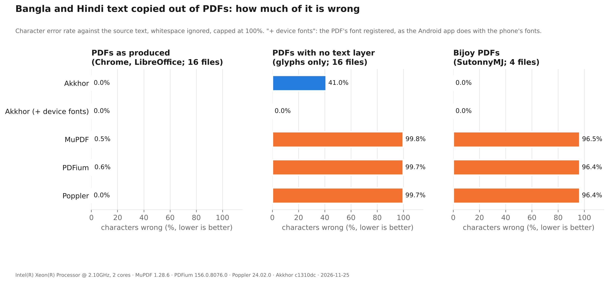

# Akkhor (অক্ষর · अक्षर)

**A tiny, fast reading engine that gets Indic scripts right: rendering, text, search and reflow.**

Akkhor opens PDF, EPUB, Kindle (MOBI, AZW3), FictionBook (FB2), comic
(CBZ) and text files, lays out and draws pages, and keeps every conjunct
whole: ক্ষ, ন্ত্র, র্ম, क्ष, त्र, श्र, द्ध. It is written in pure
Rust, memory-maps books instead of reading them, and lets you switch each
format on or off at build time.

> Status: every format in (Phases 0 to 6 done). Next, Phase 6b: what the reader app's screens need from the engine; then the Android app, in its own repository. See [the plan](docs/PLAN.md) for results and the roadmap. The Android interface is versioned (`apiVersion` 1); the Rust API may still change.

## Why

Current engines either render Indic text correctly by carrying a whole browser
engine, or stay light and break conjuncts. PDFs in Bangla and Hindi give
garbage when you copy or search, especially legacy Bijoy and Kruti Dev files.
Akkhor aims to be light **and** correct. The full gap analysis is in
[docs/PLAN.md](docs/PLAN.md#1-why-this-exists-the-gaps-we-fill).

## What works today

- **PDF:** opens from a memory map (a 308 MB, 2,000-page file opens in 5 to 89 ms with ~7 MB of heap), renders any tile of any page at any zoom straight into your pixel buffer.
- **EPUB 2/3:** own zip reader that only reads the archive index, metadata, reading order, table of contents, chapters parsed on demand, linked stylesheets, pictures (PNG, JPEG).
- **Kindle:** MOBI 7, AZW, AZW3 (KF8), older combined files and PalmDOC, both compressions (PalmDOC and HUFF/CDIC), with metadata, cover, contents, headings and pictures. In 15 test books in Bangla, Hindi and English, every word comes out in order (MuPDF reads no AZW3 and about half the Bangla words elsewhere). DRM-protected books, KFX and Topaz are recognised and refused, never opened.
- **FictionBook:** FB2 and FB2.ZIP in UTF-8, Windows-1251 or KOI8-R: sections as chapters, notes, poems, pictures, series and cover.
- **Comics:** CBZ with JPEG, PNG, WebP and GIF pages in natural order (page 2 before page 10), `ComicInfo.xml` (title, series, cover, right-to-left manga), drawn tile by tile like a PDF page. CBR and CB7 are recognised and refused.
- **PDF reflow:** a page's text as headings and paragraphs in reading order (columns, running headers and page numbers left out, hyphens joined, footnotes), tables row by row or as a picture when wide, cards box by box, pictures from sideways pages turned upright, with every position mapped back to the page.
- **Plain text:** UTF-8, UTF-16 and Windows-1252, and detection of Bijoy-encoded Bangla.
- **Indic-correct text:** OpenType shaping (HarfRust), and orthographic-syllable rules for Bangla, Devanagari, Gurmukhi, Gujarati, Odia, Tamil, Telugu, Kannada and Malayalam. Line breaks, taps, selections and highlights never split a conjunct.
- **Search that understands Indic spellings:** nukta letters, split vowels, ৎ / ত্‍, ZWJ/ZWNJ and case all match their equivalents, and a search for ক never matches half of ক্ষ.
- **Layout:** a CSS subset (alignment, indents, margins, sizes, bold/italic, hidden elements, page breaks), font fallback by coverage, real or synthetic bold and italic, English hyphenation (words of 6+ letters, at most 2 hyphenated lines in a row, never at the foot of a page; Bangla and Devanagari never hyphenate), no line starting with । or a closing mark, page-by-page layout (the first page of a 1,000-page Bangla text is ready in under 1 ms), themes (paper, sepia, dusk, night, or any colours the app gives; photos dimmed to 85% on dark themes), glyphs cached as small coverage masks, so a screen redraws 2 to 2.7 times faster than from outlines.
- **For a reader app:** book info and covers (under 50 ms a book), saved places (locators) that survive font, screen and theme changes, progress, whole-book search in stoppable batches with snippets, text and boxes for highlights, sentences for read aloud, a "fonts may be missing" hint for Indic PDFs, and chosen PDF pages saved as a new PDF (copies read and draw the same in MuPDF, PDFium and Poppler).
- **Hard to break:** eleven fuzz targets (PDF, EPUB, Kindle, FB2, comics and more) run on every push; every input that crashed or hung is kept as a test.
- **Fonts on demand:** a script's font is only loaded when a book uses that script; the tables built from the phone's fonts are kept in the app's cache folder and read back in under a millisecond.
- **Android:** a JNI bridge that draws straight into a `Bitmap`; the whole interface is one Kotlin file, [`android/Native.kt`](android/Native.kt) (55 calls, explained in [docs/api/android.md](docs/api/android.md)), checked against the library and called from a JVM in CI.

## How it compares

Measured against MuPDF, PDFium and Poppler on 36 Bangla and Hindi PDFs
and a 2,000-page, 308 MB PDF; data, method, every chart and the scripts to
rerun it are in [`docs/case-study/`](docs/case-study/).



## Format switches

```toml
[dependencies]
akkhor = { version = "0.1", default-features = false, features = ["epub"] }  # EPUB only
```

| Feature | Adds |
|---|---|
| `pdf` (default) | PDF |
| `epub` (default) | EPUB 2 and 3 |
| `txt` (default) | plain text |
| `mobi` (default) | MOBI, AZW, AZW3 (KF8), combined files, PalmDOC (about 56 KB on arm64) |
| `fb2` (default) | FictionBook 2 and FB2.ZIP (about 38 KB) |
| `cbz` (default) | comic archives, WebP and GIF decoding included (about 209 KB) |
| `pdf-scans` (default) | JBIG2, CCITT fax and JPEG 2000 decoders for scanned PDFs (about 0.45 MB on arm64) |
| `pdf-cjk` | CJK character maps for Chinese, Japanese and Korean PDFs |
| `pdf-write` | chosen PDF pages saved as a new PDF (no extra dependency; on in the Android build) |
| `bundled-fonts` | Noto Serif Latin, Bengali and Devanagari compiled in |

`akkhor-flow` also has `hyphenation` (English patterns, 31 KB) and `images` (PNG/JPEG decoding), both on by default.

A format that is off is not compiled. A format that is on uses no memory until you open a file of that format.

## Try it

```sh
cargo run --release -p akkhor-cli -- tests/fixtures/indic-sample.epub --page 0 --out page.png
cargo run --release -p akkhor-cli -- tests/fixtures/indic.pdf --scale 2 --theme sepia --out pdf.png
cargo run --release -p akkhor-cli -- tests/fixtures/indic-sample.epub --search "ক্ষ"
cargo run --release -p akkhor-cli -- tests/corpus/formats/bn.azw3 --text
cargo run --release -p akkhor-cli -- tests/corpus/formats/manga.cbz --page 1 --out comic.png

# a big PDF (2,000 pages, ~300 MB) and a ~1,000-page Bangla text for benchmarking
python3 scripts/make_fixtures.py --big 2000 --image-kb 150
cargo run --release -p akkhor-cli -- tests/fixtures/big.pdf --page 1999
cargo run --release -p akkhor-cli -- tests/fixtures/big-bn.txt
```

## Use it from Rust

```rust
use akkhor::{Book, Theme};

let book = akkhor::open("book.pdf")?;
if let Book::Pdf(pdf) = &book {
    let page = pdf.render_page(0, 2.0, &Theme::PAPER)?; // RGBA8, premultiplied
    println!("{} x {}", page.width, page.height);
}
```

## Layout

| Crate | Role |
|---|---|
| `akkhor` | the facade: `open()`, `Book`, format switches |
| `akkhor-core` | memory-mapped sources, format sniffing, the zip reader, byte-budget caches, themes |
| `akkhor-pdf` | PDF loading and tiled rendering |
| `akkhor-flow` | the reflow pipeline: markup, document model, Indic syllables, fonts, shaping, layout, painting |
| `akkhor-epub` | EPUB |
| `akkhor-mobi` | MOBI, AZW, AZW3 and PalmDOC |
| `akkhor-fb2` | FictionBook 2 |
| `akkhor-cbz` | comic archives |
| `akkhor-cli` | benchmark and render tool |
| `akkhor-android` | JNI bridge (`libakkhor.so`) |

## License

Code: MIT or Apache-2.0, at your option. Fonts in `fonts/`: SIL Open Font License 1.1 (Noto). English hyphenation patterns: hyph-utf8 `en-us` (see `crates/akkhor-flow/data/hyph-en-us.LICENSE.txt`).

PDF interpretation uses [hayro](https://github.com/LaurenzV/hayro); shaping uses [HarfRust](https://github.com/harfbuzz/harfrust); rasterizing uses [vello_cpu](https://github.com/linebender/vello).
