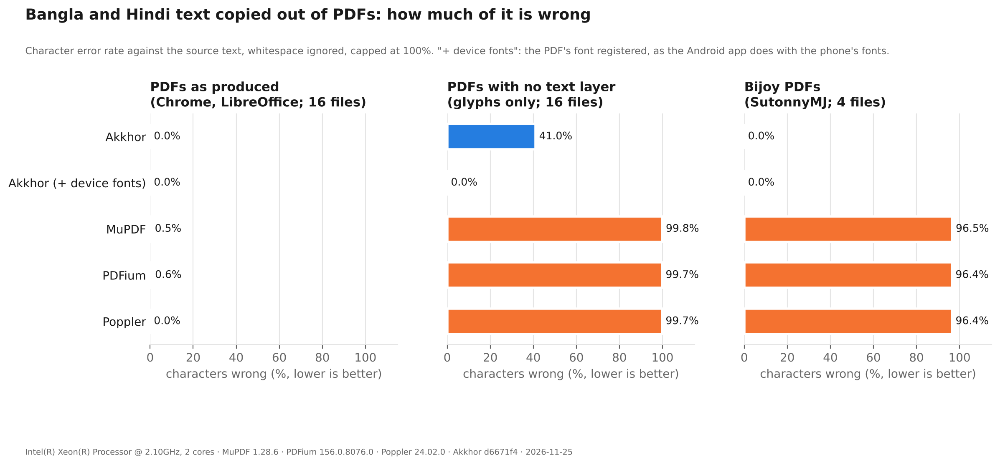
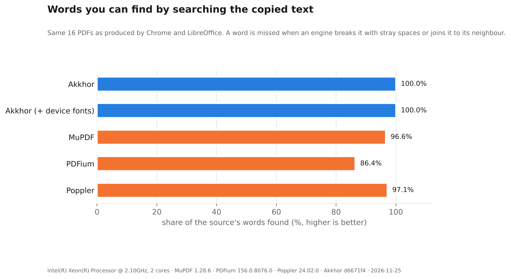
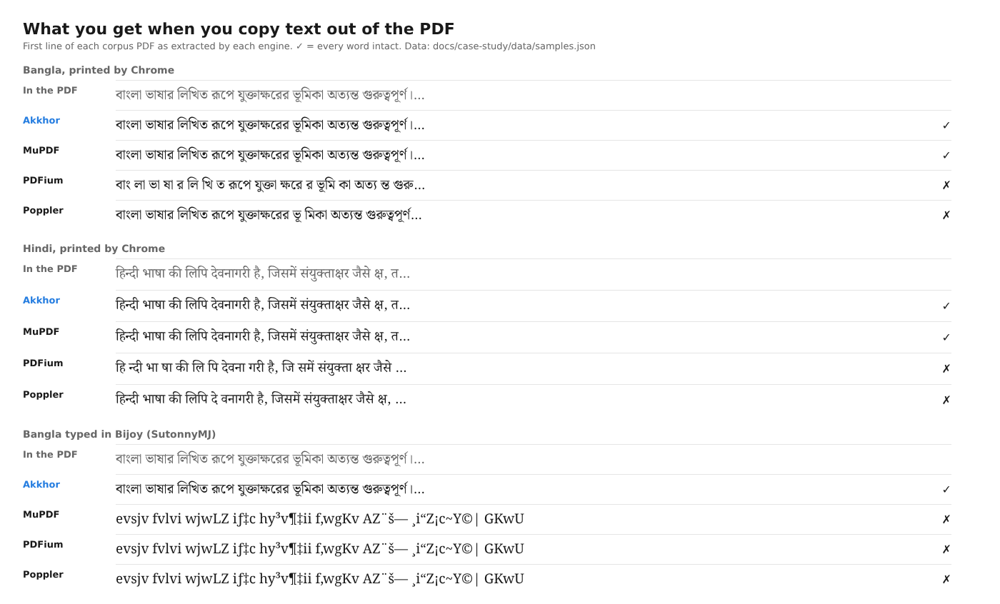
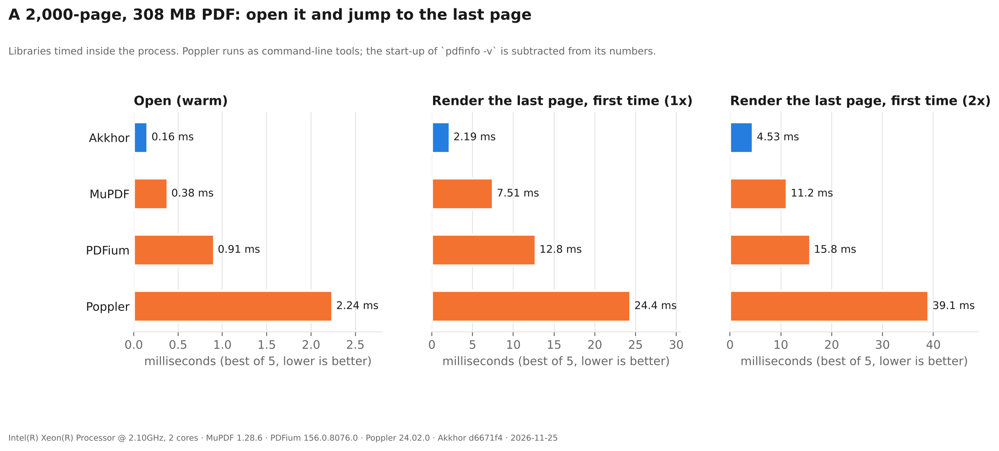
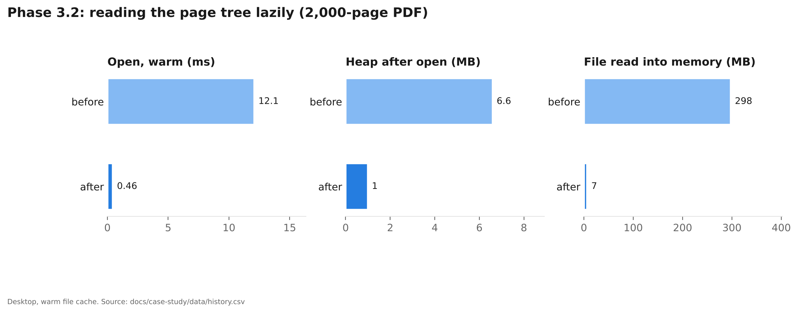
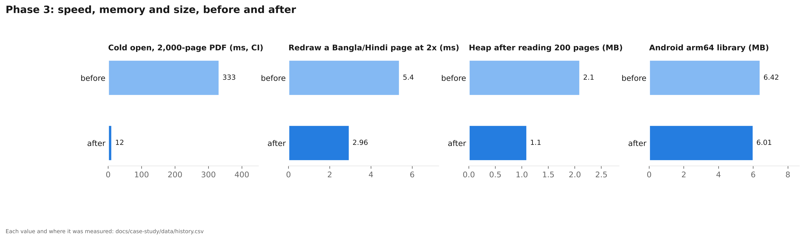
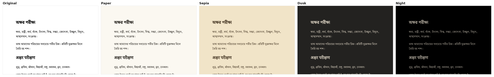
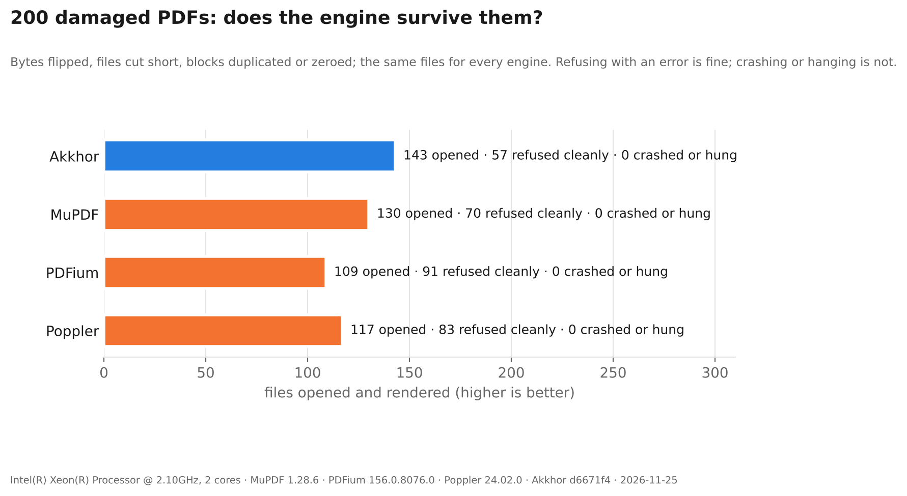

# Akkhor: a reading engine that gets Bangla and Hindi right

*Draft for the website case study. Every number links to its data in
[`data/`](data/); figures are in [`figures/`](figures/). Measured on
2026-11-25 on a 2-core cloud VM (`data/environment.json`).*

## In one paragraph

Akkhor is a small, fast engine for reading books on Android, written in
Rust. It opens PDF, EPUB and plain text, and it was built around one
question most reading engines treat as an afterthought: what happens to
Bangla and Hindi text when you copy it, search it, select it or read it
aloud. On PDFs that carry no usable text information, established engines
return 97 to 100% wrong characters; Akkhor returns the exact text when it
knows the font. Bangla typed in the old Bijoy encoding comes out as
gibberish from every other engine and as correct Unicode from Akkhor. And
it opens a 2,000-page, 308 MB PDF in 0.16 ms when the file is cached and
3 ms straight from disk.

## The problem

Bangla and Devanagari are written in syllables. A conjunct such as ক্ষ
(k + ṣ) or স্ত্র (s + t + r) is drawn as one shape, a vowel sign like ি
is drawn *before* the consonant it follows, and the reph (র্) is drawn
*after* the syllable it starts. A PDF stores the shapes, not the letters,
so getting the letters back depends on extra information the producer may
or may not have written, and on the reader interpreting it well.

What readers see in practice:

- copied text with stray spaces in the middle of words, so search misses
  them ([`figures/copied-text-samples.png`](figures/copied-text-samples.png));
- PDFs with no text information at all, from older tools, where copy and
  search return nothing useful;
- a large amount of Bangla still typed in **Bijoy**, a pre-Unicode
  encoding that only looks like Bangla in a Bijoy font. Every other engine
  hands back `evsjv fvlvi` for `বাংলা ভাষার`.

On top of that, the common engines are heavy for a phone: MuPDF's library
is 36 MB on Linux, and none of them lays out EPUB text with Indic shaping
and syllable-aware selection in the same package.

## Goals

1. Exact Bangla and Hindi text for copy, search, selection and read-aloud,
   in PDFs, EPUBs and text files, including Bijoy.
2. Light: memory-mapped files, nothing read until it is needed, each
   format a build-time switch.
3. Fast on big files: open instantly, jump to any page, render tiles at
   any zoom straight into the phone's bitmap.

## How it works

- **One engine, format switches.** PDF, EPUB and TXT are Cargo features;
  an app that only reads PDFs compiles nothing else. Files are
  memory-mapped, so a 308 MB PDF costs a few MB of memory.
- **Reflowable text** (EPUB, TXT) goes through a layout pipeline with
  HarfRust shaping, Liang hyphenation and syllable-aware hit-testing,
  selection and search, so a selection never splits a conjunct.
- **PDF rendering** uses `hayro`, a pure-Rust PDF interpreter, with my
  changes around it: tiles drawn straight into the caller's buffer, reading
  themes that keep images in their own colours, and a lazy page tree (see
  below).

### Getting the letters back from PDF glyphs

This is the core of the project. For every font embedded in a PDF:

1. **Find the full font.** PDF producers embed a stripped subset: no
   shaping rules, sometimes renumbered glyphs, sometimes a character map
   filled with junk. But a glyph's *outline* survives. Akkhor hashes every
   embedded glyph's outline and looks it up in complete copies of fonts it
   knows: its bundled Noto fonts and the phone's own fonts.
2. **Run the font's rules backwards.** In the complete font, Akkhor shapes
   candidate syllables (consonant + vowel sign, reph + consonant,
   consonant pairs, three-consonant clusters, guided by the font's own
   substitution tables) and records which glyph each one produces. A glyph
   that only appears for স্ত্র *means* স্ত্র.
3. **Put the text in reading order.** Vowel signs drawn first move after
   their consonant cluster, rephs move to the start of their syllable,
   split vowels (ে … া) are rejoined, and a reph fused with a vowel sign is
   split in two directions at once.
4. **Use what the producer wrote, when it is there.** Chrome and
   LibreOffice also write `/ActualText` spans with the correct text of
   each cluster; Akkhor reads those first.

Bijoy runs (fonts named like SutonnyMJ) are converted with a table derived
from the MIT-licensed `poriborton` crate, then reordered the same way.

## Results

### Text you can copy and search

Character error rate on 36 PDFs (Bangla and Hindi prose and full conjunct
lists, two producers, four fonts), from
[`data/text_accuracy.csv`](data/text_accuracy.csv):

| | PDFs as produced | No text layer | Bijoy |
|---|---|---|---|
| **Akkhor (+ device fonts)** | **0.0%** | **0.0%** | **0.0%** |
| Akkhor (bundled fonts only) | 0.0% | 41.0% (0.0% on Noto, 82% on unknown fonts) | 0.0% |
| MuPDF 1.28.6 | 0.5% | 99.8% | 96.5% |
| PDFium 156 | 0.6% | 99.7% | 96.4% |
| Poppler 24.02 | 0.0% | 99.7% | 96.4% |

On well-made PDFs everyone gets the characters nearly right. The
difference shows up in **search**: Akkhor keeps every word whole, while
the others break some words with stray spaces.

| Words found | Akkhor | MuPDF | PDFium | Poppler |
|---|---|---|---|---|
| 16 PDFs as produced | **100%** | 96.6% | 86.4% | 97.1% |

### Speed on a very big PDF

2,000 pages, 308 MB ([`data/speed.csv`](data/speed.csv), best of 5):

| | Open (warm) | Last page, 1x | Last page, 2x | Open from disk (cold) |
|---|---|---|---|---|
| **Akkhor** | **0.16 ms** | **2.2 ms** | **4.5 ms** | 3.0 ms |
| MuPDF | 0.38 ms | 7.5 ms | 11.2 ms | 5.8 ms |
| PDFium | 0.91 ms | 12.8 ms | 15.8 ms | **2.6 ms** |
| Poppler | 2.2 ms* | 24.4 ms* | 39.1 ms* | n/a |

\* Poppler measured through its command-line tools, start-up subtracted.

From a cold disk, opening the file *and* drawing its last page takes Akkhor
13.5 ms, MuPDF 219 ms and PDFium 185 ms
([`data/cold_open.csv`](data/cold_open.csv)): they read far more of the
file to find page 2,000.

The open time came from a change I made to the PDF parser: it used to read
the dictionary of every page when the file was opened. Reading the page
tree lazily took the warm open from 12.1 ms to 0.46 ms, the memory after
opening from 6.6 MB to 1.0 MB, and the share of the file pulled into memory
from 298 MB to 7 MB.

On the CI machine, opening the same file straight from disk went from
333 ms to 12 ms.

### Phase 3 in four numbers

- **Cold open** of the 2,000-page PDF on CI: 333 → 12 ms.
- **Redrawing** a Bangla and Hindi page at 2x: 5.4 → 3.0 ms. One render
  cache is now shared by every page and tile of a document, so fonts,
  glyph outlines and images are parsed once. Zoomed tiles of a page cost
  about 1.1 ms each after the first (6.1 ms).
- **A long reading session** grows the heap by about 7 KB a page; when
  Android asks apps to trim memory, Akkhor reopens the file in under 1 ms
  and drops back from 2.1 to 1.1 MB.
- **The Android library** (arm64): 6.42 → 5.81 MB, with scan decoders
  (JBIG2, CCITT, JPEG 2000) now a switch. A PDF-only build is 4.97 MB,
  EPUB and text only 2.19 MB.

### Reading themes

PDFs are designed as dark ink on white paper. Akkhor redraws the page in
the reader's theme by lightness: paper becomes the theme's background, ink
its text colour, colours keep their hue, and colour images keep their real
colours. Scanned pages (greyscale images) follow the theme like text.

### Robustness

200 damaged PDFs, the same files for every engine: **no engine crashed or
hung**. Akkhor shows page 1 of the most damaged files (143), then MuPDF
(130), Poppler (117) and PDFium (109); the rest are refused with an error.
"Opened" means a page was shown: my first run also counted files that
MuPDF and PDFium opened with zero pages, which gave MuPDF 180. With the
same rule for everyone, that lead was an artefact.

## Where Akkhor is behind (and what is next)

Being honest about this is part of the point:

- **Drawing the same page again.** Sharing the render cache took Akkhor
  from 5.4 to 3.0 ms on the Bangla and Hindi page, ahead of PDFium (3.7 ms)
  but still behind MuPDF (1.1 ms), which records a page once and replays
  it ([`figures/speed-redraw.png`](figures/speed-redraw.png)).
- **Memory on an Indic page at 2x:** 11.4 MB added against 7.7 to 9.1 MB
  for the others ([`figures/memory.png`](figures/memory.png)): fonts are
  parsed once for text recovery and again for drawing.
- **Unknown fonts with no text layer:** if neither the PDF nor the phone
  has the font, there is nothing to recover from.
- **Library size:** 5.8 MB on Linux and on Android (arm64) with all
  formats and Indic shaping: smaller than PDFium (6.7 MB, PDF only) and far
  below MuPDF (36 MB), but I missed my 3.5 MB target. Most of what is left
  is the shaper and font parsers, which both EPUB layout and PDF text
  recovery need.

## What I got wrong along the way

- I first assumed embedded fonts keep their shaping rules. Measuring showed
  both Chrome and LibreOffice strip them, which led to the
  reference-font design above.
- My first "before" numbers (31 to 45% wrong text) came from reading each
  glyph's `ToUnicode` entry the way the PDF library exposes it. Comparing
  with MuPDF, PDFium and Poppler showed they also read the `/ActualText`
  spans the producers write and get under 1%. I corrected the docs, added
  `/ActualText` support to Akkhor, and rebuilt the "no text layer" test set
  without those spans so it really tests recovery from glyphs.
- Night mode on PDFs was broken from the start (dark text drawn on a dark
  background) and no test caught it; I only found it when I measured
  everything before planning Phase 3. A render test now checks the colour
  of text, background and images in every theme.
- I set a 3 MB, then 3.5 MB, size target before knowing what Indic text
  recovery would need. Measuring every build showed the floor; the target
  is now 5.5 MB and the reasons are in the Phase 3 review.
- My first robustness run counted a damaged file "opened" when the
  library opened it, even with zero pages. MuPDF opens many truncated
  files that way, so it looked far ahead (180 to 143). Counting only files
  that show a page, Akkhor leads (143 to 130).
- The review of the night theme found a page that draws 100,000 small
  images made it 450 ms slower, because every pixel was checked against
  every image. A row-by-row sweep brought that to 40 ms.

## How it was built

- **A plan before every phase**, pushed to GitHub before any code, and a
  written, rigorous review after every phase with each finding fixed or
  carried forward ([`docs/reviews/`](../reviews/)).
- **A measured corpus**: 36 PDFs, a Bijoy round trip over 3,842 words,
  checked in CI on every push.
- **Robustness tests** in CI: hundreds of damaged files driven through every
  parser, renderer and the text layer.
- **This comparison**, reproducible with two scripts.

## Method, in short

Every measurement runs in a fresh process. Library calls are timed inside
the process; Poppler through its command-line tools with start-up
subtracted. Character error rate is edit distance over the length of the
source text after Unicode decomposition, whitespace ignored. Full details
and caveats: [`data/README.md`](data/README.md).
